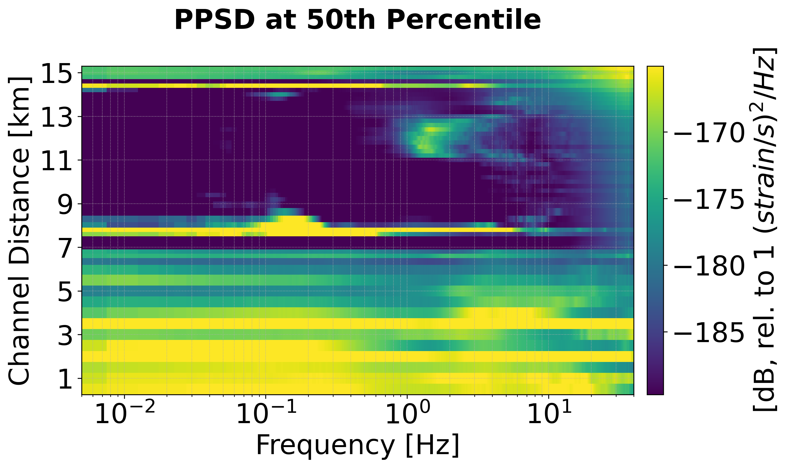
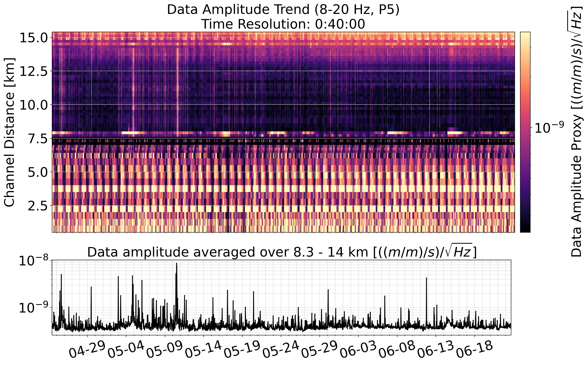
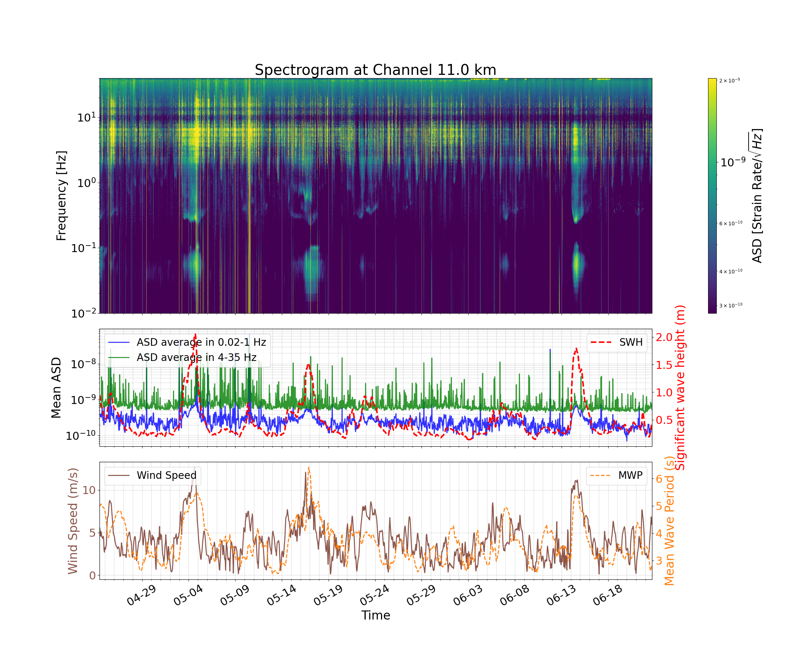
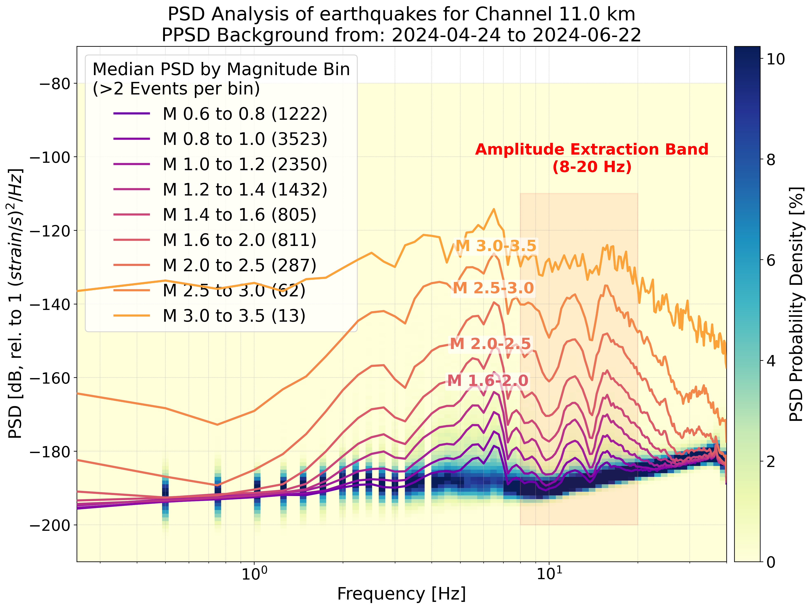

# yuhan_das_spectra — Spectral analysis tools for seafloor DAS: noise PSD/PPSD, earthquake spectra, noise–weather comparison

[](https://doi.org/10.5281/zenodo.20715241)
[](https://doi.org/10.22541/essoar.15006791/v1)
[](NOTICE)
[](requirements.txt)

A standalone spectral and meteorological analysis toolkit for seafloor Distributed Acoustic Sensing (DAS) strain-rate data (developed for the April–June 2024 Kefalonia Transform Fault deployment, Greece), covering continuous ambient noise characterization, Probabilistic Power Spectral Density (PPSD), noise–weather/wave coupling with ERA5 reanalysis, and earthquake spectral scaling — with minimum detectable magnitude ($M_c$) validation for matched-filter detection as one key application.

> **Background & archive naming.** This repository is the standalone GitHub release of `check_minmag_pkg` from the Zenodo software archive [10.5281/zenodo.20715241](https://doi.org/10.5281/zenodo.20715241) (`matched_filter_release.zip`, where its folder name remains `check_minmag_pkg/`), originally distilled as two independent spectral pipelines, an ERA5 meteorological chain, and frozen data products from the internal `check_minmag_validity/` research project without modifying the source project.

**Example outputs** (more in `noise_psd/example_outputs/` and `eq_spectra/example_outputs/`):

<table>
  <tr>
    <td width="50%"><br><sub>Median (50th-percentile) PPSD across channels, 2024-04-24 to 2024-06-22 · <code>noise_psd/3_plot_ppsd.py</code></sub></td>
    <td width="50%"><br><sub>8–20 Hz noise amplitude proxy (P5) for all 55 channels at 40-min resolution · <code>noise_psd/4_analyse_noise_trends.py</code></sub></td>
  </tr>
  <tr>
    <td width="50%"><br><sub>Noise spectrogram and band-averaged ASD at 11.0 km against ERA5 wind speed, significant wave height and mean wave period · <code>noise_psd/2_plot_results_with_wind_wave.py</code></sub></td>
    <td width="50%"><br><sub>Earthquake spectra binned by magnitude at 11.0 km over the ambient-noise PPSD, with the 8–20 Hz amplitude band highlighted · <code>eq_spectra/2_plot_psd_by_eq.py</code></sub></td>
  </tr>
</table>

---

## I. Overview of Tools

| Script / Module | What It Computes | Inputs | Outputs |
|---|---|---|---|
| `noise_psd/1_calculate_psd_h5.py` | Per-channel Welch PSD (`nperseg=200 s`, 40-min chunks, 55 channels across 0.5–15.2 km) from continuous 80 Hz DAS strain-rate records, with checkpoint resume | Continuous 80 Hz DAS HDF5 archive in `DAS_DATA_DIR` (defaults to `IN_DAS_data/`) | Daily PSD HDF5 files `noise_psd/chunk0:40:00_nperseg200s/psd_daily_h5/YYYY-MM-DD.h5` (`frequency` vector of length 8001 + `ch_X.Xkm/<timestamp>` datasets) and `config.json` |
| `noise_psd/2_plot_results_with_wind_wave.py` | 3-panel single-channel figures overlaying time–frequency PSD spectrograms and band-averaged amplitude spectral density (ASD) time series with ERA5 wind speed, significant wave height (SWH), and mean wave period (MWP) | Daily PSD HDF5 files (`psd_daily_h5/`) + ERA5 DataFrames from `meteo/load_kefa_meteo.py` | Per-channel spectrogram + meteorology PNG figures (`sg_meteo_channel_<km>.png`) and `plot_config.json` |
| `noise_psd/3_plot_ppsd.py` | Per-channel Probabilistic Power Spectral Density (PPSD, McNamara–Buland 2D frequency × dB histograms) and a multi-channel quantile summary heatmap | Daily PSD HDF5 files (`psd_daily_h5/`) | Per-channel PPSD PNGs (`ppsd_chXpXkm_*.png`), summary percentile heatmap (`ppsd_summary_<P>percentile_*.png`), and `ppsd_config.json` |
| `noise_psd/4_analyse_noise_trends.py` | 8–20 Hz, 5th-percentile (`P5`) RMS noise amplitude proxy (`sqrt(P5 of PSD)`) across all 55 channels and 2135 time steps (40-min resolution), plus two-panel heatmaps and per-channel trend subplots | Daily PSD HDF5 files (`psd_daily_h5/`) | `noise_trends_f8-20Hz_p5.h5` (frozen copy shipped in `products/noise_trends_f8-20Hz_p5.h5`), `noise_heatmap_f8-20Hz_p5.png`, `noise_subplots_f8-20Hz_p5.png`, and `noise_analysis_config.json` |
| `eq_spectra/1_calculate_psd_by_eq.py` & `1_calculate_psd_by_eq_Parallel.py` | Per-event Welch PSD (`nperseg=4 s`, window `[t_trig - 1.5 s, t_trig + 2.5 s]`) around earthquake trigger times (serial for 13 channels at 8.3–14.0 km; multiprocessing for 28 channels at 1.0–14.0 km) | Event catalogue CSV (`eq_spectra/eq_list/<MagList>/Events_classified_Real_Mag.csv`) + continuous 80 Hz DAS archive in `DAS_DATA_DIR` | Per-channel event-PSD HDF5 files `eq_spectra/eq_list/<MagList>/<Template>/psd_data_channel_<km>km.h5` (`frequency` of length 161 + `event_YYYYMMDDTHHMMSS` datasets with `magnitude` and `trigger_time` attributes) and `config.json` |
| `eq_spectra/2_plot_psd_by_eq.py` | Earthquake spectra binned by magnitude (median spectrum per magnitude bin, highlighting the 8–20 Hz amplitude extraction band) plotted against the continuous ambient noise PPSD background | Per-channel event-PSD HDF5 files (`psd_data_channel_*.h5`) + continuous daily PSD HDF5 files (for PPSD background) | Per-channel spectral comparison PNGs (`psd_analysis_ch<km>km_*.png`) and `config.json` |
| `meteo/load_kefa_meteo.py`, `meteo/acquire_era5/0_download_from_api.py`, `meteo/acquire_era5/3_to_csv.py` | Downloads ERA5 reanalysis data from the Copernicus Climate Data Store (`0_download_from_api.py`), extracts grid-point hourly CSVs (`3_to_csv.py` → `kefa_atmos_data.csv`, `kefa_wave_data.csv`), and loads time-sliced DataFrames `(atmos_df, wave_df)` (`load_kefa_meteo_data(t_start, t_end)`) | CDS API credentials (`~/.cdsapirc`) for downloading; shipped `kefa_atmos_data.csv` and `kefa_wave_data.csv` for loading | `kefa_atmos_data.csv` (`valid_time, sst, msl, wind_speed, wind_direction`), `kefa_wave_data.csv` (`valid_time, swh, mwp`), and in-memory pandas DataFrames |

---

## II. Directory Structure

```
yuhan_das_spectra/
├── README.md                  # English documentation (this file)
├── 说明文档.md                 # Chinese documentation
├── LICENSE                    # MIT License (Copyright (c) 2026 Yuhan Wang)
├── NOTICE                     # Third-party code and ERA5 data attribution
├── CITATION.cff               # Citation metadata (Zenodo DOI + preprint preferred-citation)
├── .gitignore                 # Ignores raw DAS, intermediate h5/nc, and recomputed outputs
├── requirements.txt           # Core Python dependencies (6 libraries; optional ERA5 libs in comments)
├── functions/                 # Shared low-level modules used by the pipelines (see §VII)
│   ├── README.md / 说明文档.md
│   ├── load_das_h5_PE2024.py  # Core DAS HDF5 reader (load_das_custom)
│   └── plot.py                # Matplotlib time-axis tick formatters (Ticks_xaxis_*)
├── meteo/                     # ERA5 meteorological & ocean-wave data + loader
│   ├── README.md / 说明文档.md
│   ├── load_kefa_meteo.py     # ★ Frozen loader interface: load_kefa_meteo_data(t_start, t_end)
│   ├── kefa_atmos_data.csv    # Hourly atmospheric time series (valid_time, sst, msl, wind_speed, wind_direction)
│   ├── kefa_wave_data.csv     # Hourly wave time series (valid_time, swh, mwp)
│   └── acquire_era5/          # One-time ERA5 acquisition scripts
│       ├── 0_download_from_api.py
│       └── 3_to_csv.py
├── noise_psd/                 # Pipeline A: Continuous noise PSD, PPSD, weather overlay & noise trends
│   ├── README.md / 说明文档.md
│   ├── 1_calculate_psd_h5.py
│   ├── 2_plot_results_with_wind_wave.py
│   ├── 3_plot_ppsd.py
│   ├── 4_analyse_noise_trends.py
│   └── example_outputs/       # 11 representative noise/PPSD/weather PNGs (~21 MB) + sample h5 note
├── eq_spectra/                # Pipeline B: Per-event earthquake spectra & magnitude scaling vs noise PPSD
│   ├── README.md / 说明文档.md
│   ├── 1_calculate_psd_by_eq.py
│   ├── 1_calculate_psd_by_eq_Parallel.py
│   ├── 2_plot_psd_by_eq.py
│   ├── eq_list/               # Bundled matched-filter earthquake catalogues (~11 MB)
│   │   ├── eq_list_MF_v3_40_RAWCCsMag_5-20Hz/Events_classified_Real_Mag.csv
│   │   └── eq_list_MF_v3_40_ampMag_10-35Hz/Events_classified_Real_Mag.csv
│   └── example_outputs/       # 9 representative per-channel earthquake spectrum PNGs (~11 MB) + sample h5 note
└── products/                  # Frozen downstream numerical product
    ├── README.md / 说明文档.md
    └── noise_trends_f8-20Hz_p5.h5   # ★ 8–20 Hz P5 noise amplitude time series (967 KB)
```

> **Important**: Do not rename or move the subdirectories (`noise_psd/`, `eq_spectra/`, `meteo/`, `functions/`, `products/`) or `.py` scripts inside this repository. Every script derives the repository root relative to its own file path via `_PKG_ROOT = os.path.dirname(os.path.dirname(os.path.abspath(__file__)))`.

---

## III. Data Flow Diagrams

### Pipeline A — Continuous Noise PSD, PPSD & Noise Trends (`noise_psd/`)

```
External 80 Hz DAS archive  IN_DAS_data/ (DATA_DEC_80Hz_16m_SORTED/, dx ≈ 16.34 m)
   │  functions/load_das_h5_PE2024.load_das_custom
   ▼
[1_calculate_psd_h5.py] --Welch(nperseg=200 s, chunk=40 min, 55 channels)-->
        noise_psd/chunk0:40:00_nperseg200s/psd_daily_h5/YYYY-MM-DD.h5  (per day; tens of GB, not packaged)
   │
   ├─> [2_plot_results_with_wind_wave.py] --(overlaid with meteo)--> spectrogram + ASD time series + SWH/wind PNG
   │         ▲ meteo/load_kefa_meteo.load_kefa_meteo_data → kefa_*_data.csv
   ├─> [3_plot_ppsd.py] --> per-channel PPSD + quantile summary heatmap PNG
   └─> [4_analyse_noise_trends.py] --(8–20 Hz, P5, sqrt)-->
              noise_trends_f8-20Hz_p5.h5  ★ (= frozen product in products/) → yuhan-mfdas
```

### Pipeline B — Per-Magnitude Earthquake Spectra (`eq_spectra/`)

```
Event list  eq_list/<MagList>/Events_classified_Real_Mag.csv   (included in repository, tab-separated)
External 80 Hz DAS archive  IN_DAS_data/ ───────┐
                                                ▼
[1_calculate_psd_by_eq(.py / _Parallel.py)] --Welch(nperseg=4 s, window [-1.5 s, +2.5 s] around trigger)-->
        eq_list/<MagList>/<Template>/psd_data_channel_*.h5  (large, recomputed on demand, not packaged)
                                                │
Continuous daily PSD (psd_daily_h5/) ───────────┤  (as PPSD background)
                                                ▼
[2_plot_psd_by_eq.py] --(magnitude-binned median spectra + PPSD background + 8–20 Hz band)--> PNG
```

### Meteorological Chain (`meteo/acquire_era5/`)

```
CDS / ERA5  --[0_download_from_api.py (cdsapi)]--> *.nc
            --[3_to_csv.py (xarray, point extraction at 38.5° N, 20.5° E)]--> kefa_atmos_data.csv / kefa_wave_data.csv
                                                                              ▲ load_kefa_meteo.py reads these
                                                                                (used by Pipeline A/2_ and yuhan-mfdas)
```

---

## IV. Quickstart

```bash
# 1. Install dependencies (6 core libraries for reading products and running PSD/plotting pipelines;
#    install commented-out xarray/cdsapi etc. only when re-downloading ERA5 data)
pip install -r requirements.txt        # Python 3.11 (dev env: salvus; pins numpy<2.4)

# 2A. Use pre-built products immediately (no raw DAS data or heavy compute needed):
#   - Noise amplitude h5:  products/noise_trends_f8-20Hz_p5.h5
#   - Meteorological data:
python -c "import sys; sys.path.append('meteo'); \
from load_kefa_meteo import load_kefa_meteo_data; \
from datetime import datetime; \
a,w=load_kefa_meteo_data(datetime(2024,4,24),datetime(2024,6,22)); \
print(a.columns.tolist(), w.columns.tolist())"

# 2B. Recompute continuous noise PSD from scratch (requires external 80 Hz DAS archive + compute time):
#   Place or symlink the 80 Hz DAS archive at IN_DAS_data/ (the default DAS_DATA_DIR), or edit
#   DAS_DATA_DIR at the top of noise_psd/1_calculate_psd_h5.py
python noise_psd/1_calculate_psd_h5.py             # → noise_psd/chunk.../psd_daily_h5/*.h5
python noise_psd/4_analyse_noise_trends.py         # → noise_trends_f8-20Hz_p5.h5 (recomputed)
python noise_psd/3_plot_ppsd.py                    # → PPSD plots
python noise_psd/2_plot_results_with_wind_wave.py  # → PSD spectrogram + meteorological overlay

# 2C. Recompute per-magnitude earthquake spectra:
#   DAS archive as in 2B (DAS_DATA_DIR in eq_spectra/1_*.py); event lists are in eq_spectra/eq_list/
python eq_spectra/1_calculate_psd_by_eq.py         # or _Parallel.py → psd_data_channel_*.h5
python eq_spectra/2_plot_psd_by_eq.py              # requires continuous PSD for PPSD background

# 2D. Recompute meteorological CSVs (one-time, requires ~/.cdsapirc):
python meteo/acquire_era5/0_download_from_api.py   # download ERA5 .nc files
python meteo/acquire_era5/3_to_csv.py              # .nc → kefa_*_data.csv
```

---

## V. Data Availability & Sources

- **Shipped in this repository (~44 MB across 62 files)**:
  - `products/noise_trends_f8-20Hz_p5.h5` (967 KB): frozen 8–20 Hz P5 noise amplitude time series across 55 channels (2024-04-24 to 2024-06-22);
  - `meteo/kefa_atmos_data.csv` and `meteo/kefa_wave_data.csv` (~109 KB total): hourly ERA5 atmospheric and wave time series;
  - `eq_spectra/eq_list/eq_list_MF_v3_40_RAWCCsMag_5-20Hz/Events_classified_Real_Mag.csv` and `eq_spectra/eq_list/eq_list_MF_v3_40_ampMag_10-35Hz/Events_classified_Real_Mag.csv` (~10.5 MB total): matched-filter earthquake catalogues (~13,492 events each);
  - 20 representative example PNG figures (~32 MB total) in `noise_psd/example_outputs/` (11 figures) and `eq_spectra/example_outputs/` (9 figures).
  - No raw DAS data are included.
- **Available in the Zenodo archive ([10.5281/zenodo.20715241](https://doi.org/10.5281/zenodo.20715241))**:
  - In `matched_filter_release.zip`, this package lives under the folder name `check_minmag_pkg/`.
  - The 69.3 MB single-day intermediate PSD sample `check_minmag_pkg/noise_psd/example_outputs/sample_intermediate_psd_daily/2024-04-24.h5` (72,712,352 bytes) is archived in `matched_filter_release.zip` on Zenodo (omitted from this GitHub repository to keep file sizes under 50 MB; see `noise_psd/example_outputs/sample_intermediate_psd_daily/README.md`). Copy it into `noise_psd/chunk0:40:00_nperseg200s/psd_daily_h5/` to test scripts `2_`, `3_`, and `4_` on one day of data without raw DAS.
  - The single-channel event-PSD sample `psd_data_channel_11.0km.h5` is also omitted from this GitHub repository because its HDF5 attributes store a machine-specific path (see `eq_spectra/example_outputs/sample_intermediate_psd_by_event/README.md`).
  - Recomputing full daily or per-event PSDs from scratch requires the continuous 80 Hz DAS archive (~1.4 TB), which is neither in this repository nor in the Zenodo archive.
- **ERA5 Reanalysis Attribution**:
  - `meteo/kefa_atmos_data.csv` and `meteo/kefa_wave_data.csv` are point extractions (nearest grid point to 38.5° N, 20.5° E, hourly, 2024-04-24 to 2024-06-22) from the **ERA5** reanalysis (Hersbach et al., 2020, https://doi.org/10.1002/qj.3803), produced by ECMWF for the **Copernicus Climate Change Service (C3S)** and obtained from the Copernicus Climate Data Store. Contains modified Copernicus Climate Change Service information. Neither the European Commission nor ECMWF is responsible for any use that may be made of the Copernicus information or data it contains. Licensed under [CC BY 4.0](https://creativecommons.org/licenses/by/4.0/). See [`NOTICE`](NOTICE).

---

## VI. Data Interface with `yuhan-mfdas` (Frozen Contract)

This toolkit supplies two frozen interfaces to the companion matched-filter workflow repository **`WANGYuhan2002/yuhan-mfdas`** (folder `yuhan_dasmf_v1.0/` inside `matched_filter_release.zip` on Zenodo):

### Interface A — Meteorological Loading Module (`meteo/load_kefa_meteo.py`)
- **Function signature**: `load_kefa_meteo_data(t_start, t_end, data_dir=None)` → `(atmos_df, wave_df)`
- `atmos_df` contains column `wind_speed` (plus `sst, msl, wind_direction`); `wave_df` contains column `swh` (plus `mwp`), indexed by UTC datetime.
- `yuhan-mfdas` (`Output_1_SCCs_and_MAD/MAD_arrays/999_plot_MADarr_with_meteo_and_stalta.py`) uses `atmos_df['wind_speed']` and `wave_df['swh']`.
- Defaults to reading `kefa_atmos_data.csv` and `kefa_wave_data.csv` from the module's own directory (`os.path.dirname(__file__)`); can be overridden with `data_dir=`.

### Interface B — Noise Amplitude HDF5 (`products/noise_trends_f8-20Hz_p5.h5`)
- **Dataset `noise_amplitude`**: `float64`, shape `(2135, 55)` = `[time steps, channels]`.
- **Dataset `channels_km`**: `float64`, shape `(55,)`, `0.5 … 15.2` km.
- **Dataset `timestamps_utc_str`**: `|S19`, format `%Y-%m-%dT%H:%M:%S` (`2024-04-24T10:20:00` … `2024-06-22T17:00:00`).
- **Attributes**: `amplitude_unit="(strain/s)/sqrt(Hz)"`, `amplitude_description="sqrt(P5 of PSD)"`, `frequency_band_hz="(8, 20)"`, `time_step_duration="0:40:00"`, `description`, `creation_date_utc`.
- **Consumption in `yuhan-mfdas`**: `Run_4_assign_overlaps_with_kurtosis/5_Show_withMag_noise_Mc_bvalue_slip_momentum.py` reads the three datasets and averages over the 9–14 km channels (`channels_to_avg = [9, 10, 11, 12, 13, 14]`) along the channel dimension to obtain a single noise amplitude time series for the joint seismicity–noise–$M_c$–$b$-value–slip plot.

> **Note on `yuhan-mfdas` GitHub vs. Zenodo packaging**: The GitHub repository `WANGYuhan2002/yuhan-mfdas` only ships `load_kefa_meteo.py` inside its `IN_noise_meteo/` directory (data files are gitignored there). The data files `noise_trends_f8-20Hz_p5.h5`, `kefa_atmos_data.csv`, and `kefa_wave_data.csv` live right here in `WANGYuhan2002/yuhan_das_spectra` (`products/` and `meteo/`) as well as in the Zenodo archive `matched_filter_release.zip`.

---

## VII. Technical Notes

### 1. Why `functions/` Only Includes `load_das_h5_PE2024.py` and `plot.py`

A dependency audit across all 7 analysis scripts in `noise_psd/` and `eq_spectra/` shows that only two modules from `functions/` are imported:

| Script | Imported `functions/` symbols |
|---|---|
| `noise_psd/1_calculate_psd_h5.py` | `load_das_h5_PE2024` |
| `noise_psd/2_plot_results_with_wind_wave.py` | `load_das_h5_PE2024` + `plot` (`Ticks_xaxis_*`) |
| `noise_psd/3_plot_ppsd.py` | *(none)* |
| `noise_psd/4_analyse_noise_trends.py` | `load_das_h5_PE2024` + `plot` (`Ticks_xaxis_*`) |
| `eq_spectra/1_calculate_psd_by_eq.py` | `load_das_h5_PE2024` |
| `eq_spectra/1_calculate_psd_by_eq_Parallel.py` | `load_das_h5_PE2024` |
| `eq_spectra/2_plot_psd_by_eq.py` | *(none)* |

- `load_das_h5_PE2024.py` is completely self-contained (importing only Python standard library modules, `h5py`, and `numpy`, with no dependency on `pydas_readers/` or `block_filters.py`).
- `plot.py` only imports `matplotlib` and `numpy`.
- Unused modules from the broader workflow (`pydas_readers/`, `compute_correlation`, `trigger`, `classify`, `stalta`, etc.) are therefore excluded.

### 2. Path De-Hardcoding (`_PKG_ROOT` and `DAS_DATA_DIR`)

- Every `.py` script derives the repository root dynamically via `_PKG_ROOT = os.path.dirname(os.path.dirname(os.path.abspath(__file__)))` and appends `functions/` and `meteo/` to `sys.path`, requiring no hardcoded absolute paths or environment variables.
- External continuous 80 Hz DAS paths are exposed at the top of `noise_psd/1_calculate_psd_h5.py`, `eq_spectra/1_calculate_psd_by_eq.py`, and `eq_spectra/1_calculate_psd_by_eq_Parallel.py` as `DAS_DATA_DIR = os.path.join(_PKG_ROOT, 'IN_DAS_data') + os.sep` (place or symlink the 80 Hz archive `DATA_DEC_80Hz_16m_SORTED/` at `IN_DAS_data/`, or edit `DAS_DATA_DIR` when switching machines).

---

## VIII. Known Issues

1. **`numpy<2.4` requirement**: `requirements.txt` pins `numpy<2.4` because `functions/load_das_h5_PE2024.py` calls `int(offset_index)` on a one-element NumPy array, which raises `TypeError` in NumPy 2.4+ when reading raw DAS files.
2. **Silent exit 0 when DAS data are missing**: When `DAS_DATA_DIR` does not contain raw DAS files, `noise_psd/1_calculate_psd_h5.py` does not raise an error; it writes 60 empty daily HDF5 files (containing only the `frequency` dataset and empty channel groups) and exits with status `0`. Verify `DAS_DATA_DIR` before running.
3. **Colons in output directory names on Windows**: Scripts create subdirectories such as `noise_psd/chunk0:40:00_nperseg200s/` and `..._step0:40:00/` whose names contain `:`, which Windows filesystems do not allow. Run on Linux or macOS (or WSL).
4. **`eq_spectra` event-list selection (`RAWCCsMag_5-20Hz` vs `ampMag_10-35Hz`)**: Two event lists are shipped in `eq_spectra/eq_list/` (`eq_list_MF_v3_40_RAWCCsMag_5-20Hz/` and `eq_list_MF_v3_40_ampMag_10-35Hz/`, ~5 MB each). In the shipped code, all three scripts (`1_calculate_psd_by_eq.py`, `1_calculate_psd_by_eq_Parallel.py`, and `2_plot_psd_by_eq.py`) point to `eq_list_MF_v3_40_RAWCCsMag_5-20Hz` by default (`EVENT_LIST_DIR` / `MagList_subdir`), so the pipeline is consistent end-to-end. To switch to `ampMag_10-35Hz`, update all three scripts together.
5. **PPSD background resolution in `eq_spectra/2_plot_psd_by_eq.py` (10 min / 40 s vs. 40 min / 200 s)**: `2_plot_psd_by_eq.py` looks for continuous daily PSD files in `noise_psd/chunk0:10:00_nperseg40s/psd_daily_h5/` (10-min chunks, `nperseg=40 s`), whereas `noise_psd/1_calculate_psd_h5.py` defaults to 40-min chunks and `nperseg=200 s` (`chunk0:40:00_nperseg200s/`). If the 10 min / 40 s directory is absent, `2_plot_psd_by_eq.py` skips the PPSD background and plots the earthquake spectra alone; to include the PPSD background, either run `noise_psd/1_calculate_psd_h5.py` with 10 min / 40 s parameters or point `CONTINUOUS_PSD_DIR` to an existing daily PSD directory.
6. **ERA5 `0_download_from_api.py` (monthly-mean request) vs. `3_to_csv.py` (hourly CSVs) mismatch**: `meteo/acquire_era5/0_download_from_api.py` requests ERA5 *monthly-mean* datasets (`reanalysis-era5-single-levels-monthly-means`, `reanalysis-era5-wave-monthly-means`) and writes `kefalonia_atmospheric_data.nc` / `kefalonia_wave_data.nc`, whereas `3_to_csv.py` reads hourly files `kefa_wind/data_stream-oper_stepType-accum.nc`, `kefa_wind/data_stream-oper_stepType-instant.nc`, and `kefa_wind/data_stream-wave_stepType-instant.nc`, and the two shipped CSVs (`kefa_atmos_data.csv`, `kefa_wave_data.csv`) are hourly time series. The two scripts therefore do not chain as shipped; use the pre-built hourly CSVs in `meteo/`, or update the CDS request to hourly ERA5 datasets before re-downloading.

---

## IX. Citation

If you use this software or its products, please cite the accompanying paper (preprint):

> Wang, Y., Meier, M.-A., Bogris, A., Simos, C., Simos, I., Melis, N. S., & Fichtner, A. (2026).
> *Persistent Faulting Activity Along the Kefalonia Transform Fault Revealed by Seafloor DAS*
> [Preprint]. https://doi.org/10.22541/essoar.15006791/v1

and the Zenodo software archive (v1.0.0): https://doi.org/10.5281/zenodo.20715241 (concept DOI: https://doi.org/10.5281/zenodo.20715240). See [`CITATION.cff`](CITATION.cff).

---

## X. License

MIT License — see [`LICENSE`](LICENSE). Copyright (c) 2026 Yuhan Wang.

Exceptions (see [`NOTICE`](NOTICE)):
- `functions/load_das_h5_PE2024.py` is third-party code by Pascal Edme (ETH Zürich), derived from original code by Sara Klaasen and Daniel Bowden, redistributed here for research and reproducibility with the permission of the original authors.
- `meteo/kefa_atmos_data.csv` and `meteo/kefa_wave_data.csv` contain modified Copernicus Climate Change Service (ERA5) information and are licensed under [CC BY 4.0](https://creativecommons.org/licenses/by/4.0/).
